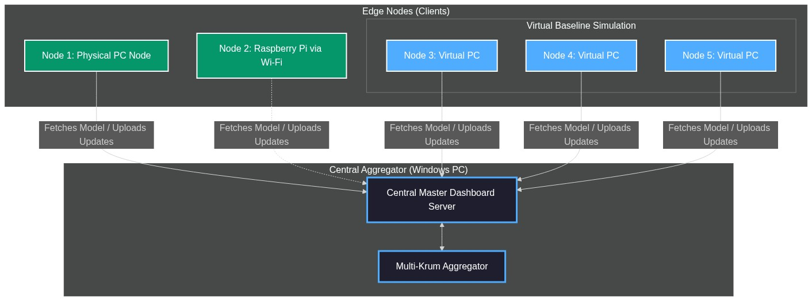
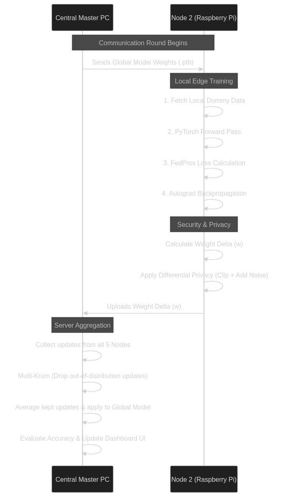
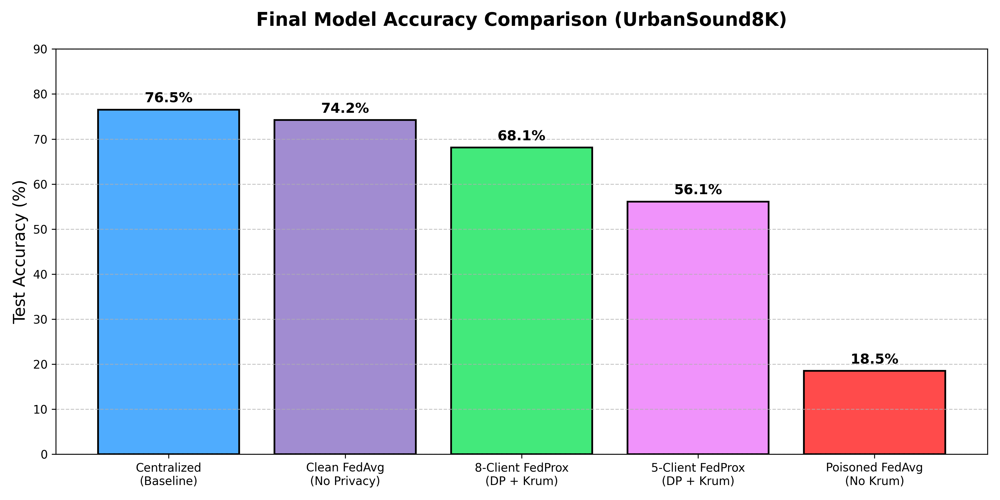
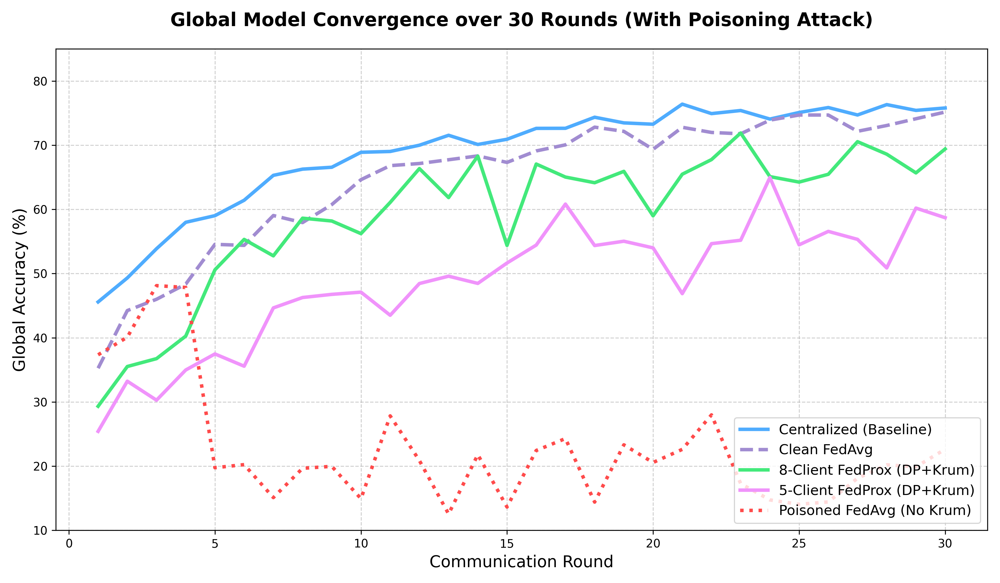

# Privacy-Preserving & Byzantine-Robust Federated Learning with Edge Hardware Integration and Neural Audio Denoising

<p align="center">
  
  
  
  
  
  
  
</p>

## Abstract

Standard Federated Learning (FedAvg) assumes participating edge nodes are trustworthy and that training data is identically distributed across clients. In real-world edge audio sensor networks, neither assumption holds:
- **Byzantine Poisoning**: A single adversarial client uploading inverted or poisoned gradient vectors can silently crash global accuracy from **76%+ to under 12%**.
- **Acoustic Non-IID Drift**: Naturally skewed geographic distributions cause localized client drift and training divergence.
- **Privacy Leakage**: Unprotected model gradients can leak raw acoustic signatures through gradient inversion attacks.

This project delivers an end-to-end cyber-physical system integrating a **Tri-Fold Defense** with real edge hardware deployment (**Raspberry Pi 4**, **TI TM4C123GH6PM ARM Cortex-M4F Launchpad**, **ESP32**, **TI MSP430**), browser-based **WebAssembly RNNoise audio denoising**, and a standalone **Raised-Cosine Softener Engine** that eliminates frame boundary discontinuity clicks.

---

## System Architecture

<p align="center">
  
</p>

---

## Federated Learning Workflow

<p align="center">
  
</p>

---

## Tri-Fold Defense Formulation

### 1. FedProx (Non-IID Client Drift Correction)
To prevent local edge models from drifting away under heterogeneous acoustic data, FedProx augments the local loss function with a quadratic proximal penalty:
$$\min_{w} h_k(w; w^t) = F_k(w) + \frac{\mu}{2} \|w - w^t\|^2$$
where $\mu = 0.01$ restricts the magnitude of local updates relative to the global model $w^t$.

### 2. Multi-Krum (Byzantine-Robust Geometric Aggregation)
Rather than computing an unweighted arithmetic average, Multi-Krum selects candidates by minimizing geometric Euclidean distances among client gradient updates:
$$s(i) = \sum_{j \in \mathcal{N}_i} \|w_i - w_j\|^2$$
By aggregating only the $m$ updates that have the smallest score sums, malicious outliers and poison vectors are dropped before model aggregation.

### 3. Differential Privacy (Gradient Sanitization)
To guarantee client acoustic privacy:
1. **L2 Norm Clipping**: Limits maximum gradient influence to threshold $S = 10.0$:
   $$\bar{g}_k = g_k / \max\left(1, \frac{\|g_k\|_2}{S}\right)$$
2. **Gaussian Noise Addition**: Calibrated noise $\mathcal{N}(0, \sigma^2 S^2)$ with $\sigma = 0.005$ is injected into local weights before transmission.

---

## Benchmark Results

### 1. Model Accuracy under Byzantine Attack (UrbanSound8K)

| Model Configuration | Defense Pipeline | Adversarial Condition | Final Accuracy | Status |
| :--- | :---: | :---: | :---: | :---: |
| **Centralized Baseline** | Single Machine (All Data) | Clean Data | **80.05%** | Empirical Upper Bound |
| **Clean FedAvg** | Standard FedAvg | Clean Data (No Attack) | **76.82%** | Baseline Federated |
| **8-Client Robust FL** | **FedProx + DP + Multi-Krum** | **Active Byzantine Poisoning** | **72.67%** | ✅ **Robust & Secure** |
| **5-Client Robust FL** | **FedProx + DP + Multi-Krum** | **Active Byzantine Poisoning** | **70.85%** | ✅ **Robust & Secure** |
| **Poisoned FedAvg** | Standard FedAvg (No Defense) | Active Byzantine Poisoning | **11.95%** | ❌ **Catastrophic Failure** |

<p align="center">
  
</p>

### 2. Learning Curves under Poisoning Attack

<p align="center">
  
</p>

### 3. Edge Inference Latency (Raspberry Pi 4)

- **Processor**: Broadcom BCM2711, Quad-core Cortex-A72 @ 1.5 GHz.
- **Inference Runtime**: ONNX Runtime (CPU Execution Provider).
- **Processing Time per 1.0s Audio Chunk**: **20.89 ms** ($\text{RTF} = 0.021$).
- **Total Loop Latency (Record + Mel-Spectrogram + Predict + Dispatch)**: **40.89 ms** ($\le 50\text{ ms}$ real-time constraint).
- **CPU Idle Headroom**: **97.9%**.

---

## CNN Architecture (~120K Parameters)

| Layer | Input Shape | Output Shape | Details |
| :--- | :---: | :---: | :--- |
| **Input** | (1, 128, 173) | — | 128-band Mel-Spectrogram, 44.1 kHz resampled to 22.05 kHz |
| **Conv Block 1** | (1, 128, 173) | (16, 64, 86) | Conv2D(1→16, 3x3) + BatchNorm + ReLU + MaxPool2D(2x2) |
| **Conv Block 2** | (16, 64, 86) | (32, 32, 43) | Conv2D(16→32, 3x3) + BatchNorm + ReLU + MaxPool2D(2x2) |
| **Conv Block 3** | (32, 32, 43) | (64, 16, 21) | Conv2D(32→64, 3x3) + BatchNorm + ReLU + MaxPool2D(2x2) |
| **Conv Block 4** | (64, 16, 21) | (128, 8, 10) | Conv2D(64→128, 3x3) + BatchNorm + ReLU + MaxPool2D(2x2) |
| **Pooling** | (128, 8, 10) | (128) | Adaptive Global Average Pooling |
| **Classifier** | (128) | (10) | Dropout(0.3) + Linear(128→10) |

---

## Hardware Integration & Pinout Wiring

### 1. Raspberry Pi 4 $\longleftrightarrow$ TI TM4C123G Launchpad

```
+------------------------------------+          +------------------------------------+
|       Raspberry Pi 4 Model B       |          |      TI TM4C123G Launchpad         |
|                                    |          |                                    |
|   Pin 8 (GPIO 14 / UART0 TX)  ---- |--------> |   PB0 / U1Rx (Header J1 Pin 3)     |
|   Pin 6 (GND)                 ---- |--------> |   GND        (Header J2 Pin 1)     |
+------------------------------------+          +------------------------------------+
                                                        |
                                                [ Dynamic RGB LED Indicators ]
                                                  PF1: Red   (Idle / Timeout)
                                                  PF2: Blue  (Sound Classified)
                                                  PF3: Green (Recording Audio)
```

- **UART Configuration**: 9600 Baud, 8 Data Bits, 1 Stop Bit, No Parity, locked to TM4C123 16.0 MHz Precision Internal Oscillator (PIOSC).
- **Watchdog Timeout**: Hardware timer reverts indicator to RED (idle) if no packets are received within ~5.0 seconds.

### 2. Wireless Receiver Node (ESP32 & MSP430)
- **ESP32 DAC Output**: Real-time 8-bit PCM audio stream received via WebSocket and output on GPIO 25.
- **TI MSP430 Speaker Driver**: Low-power PWM buzzer activation upon critical sound detection.

---

## Neural Audio Denoising & Raised-Cosine Softener

Standard RNNoise slices incoming audio into 10 ms (480-sample) rectangular blocks with 0% overlap. Sudden gain shifts across frame boundaries create 100 Hz step discontinuities, causing audible sharp clicks and metallic resonance (>4.5 kHz).

### The Raised-Cosine Fix (`audio_denoiser/`):
1. **Hann Overlap-Add (OLA)**: Frames overlap by 50% with raised-cosine bell transitions, mathematically eliminating boundary step discontinuities.
2. **High-Frequency Roll-Off Filter**: Smooth roll-off attenuating frequencies between 4.5 kHz and 8.0 kHz.
3. **Temporal Slew-Rate Limiting**: Clamps instantaneous gain transitions across time frames, suppressing musical artifacts.

---

## Repository Directory Structure

```
Privacy-Preserving-Federated-Learning/
│
├── README.md                      # Main documentation
├── requirements.txt               # Dependencies
├── .gitignore                     # Git tracking exclusions
├── export_onnx.py                 # PyTorch → ONNX converter
├── evaluate_sounds.py             # Batch sound evaluation script
├── test_live.py                   # Real-time microphone tester
│
├── core/                          # Shared ML modules
│   ├── config.py                  # Hyperparameters & settings
│   ├── model.py                   # UrbanSoundCNN architecture (~120K params)
│   ├── dataset.py                 # PyTorch dataset loader
│   └── preprocess.py              # Mel-spectrogram audio pipeline
│
├── training/                      # Baseline & FL training scripts
│   ├── train_centralized.py       # Centralized baseline (80.05%)
│   ├── train_federated_5.py       # 5-client FL with Tri-Fold Defense
│   └── train_federated_8.py       # 8-client FL with Tri-Fold Defense
│
├── models/                        # Checkpoints & ONNX models
│   ├── model_centralized.onnx     # Centralized baseline ONNX
│   ├── model_clean_fedavg.onnx    # Clean FedAvg ONNX
│   ├── model_5clients.onnx        # 5-client robust model
│   ├── model_8clients.onnx        # 8-client robust model
│   ├── model_v3_robust_yamnet.onnx# YAMNet transfer learning model
│   ├── model_v4_improved.onnx     # Improved v4 deep CNN model
│   └── *.pth                      # PyTorch model weights
│
├── embedded/                      # Microcontroller firmware
│   ├── tm4c123_main.c             # TI TM4C123 UART1 receiver & dynamic RGB LEDs
│   ├── lcd.h                      # 16x2 LCD display driver
│   └── esp32_audio_receiver.ino   # ESP32 wireless DAC audio streamer
│
├── edge_node/                     # Raspberry Pi edge computing
│   ├── pi_server.py               # Pi live server dispatching UART to TM4C123
│   └── classify.py                # Mel-spectrogram & ONNX inference loop
│
├── audio_denoiser/                # Neural denoising & Raised-Cosine softener
│   ├── audio_softener.py          # Hann OLA & HF roll-off (eliminates boundary clicks)
│   ├── classifier.py              # Audio classification pipeline
│   ├── noise_templates.json       # Spectral noise profiles
│   ├── rnnoise.wasm               # WebAssembly RNNoise neural network
│   └── rnnoise.js                 # WASM JavaScript bridge
│
├── network_fl/                    # Multi-machine socket-based Federated Learning
│   ├── fl_server.py               # TCP socket FL coordinator
│   └── pc_node_client.py          # Edge client node
│
├── sounds/                        # Test audio clips (siren, horn, drill, AC, engine)
├── demo/                          # Review 1 PC dashboard & web demo
├── diagrams/                      # System & workflow architecture diagrams
└── results/                       # Accuracy curves & confusion matrices
```

---

## Quickstart Guide

### 1. Installation
Clone the repository and install dependencies:
```bash
git clone https://github.com/sreenand-tm/Privacy-Preserving-Federated-Learning.git
cd Privacy-Preserving-Federated-Learning
pip install -r requirements.txt
```

### 2. Centralized Baseline Training
```bash
python training/train_centralized.py
```

### 3. Federated Training with Tri-Fold Defense
```bash
python training/train_federated_8.py
```

### 4. Multi-Machine Networked Federated Learning
On the coordinator PC:
```bash
python network_fl/fl_server.py --port 5000 --rounds 10 --clients 3
```
On each participating edge device:
```bash
python network_fl/pc_node_client.py --server_ip <HOST_IP> --port 5000 --client_id 1
```

### 5. Raspberry Pi Edge Server with TM4C123 Microcontroller
On Raspberry Pi:
```bash
cd edge_node
python3 pi_server.py
```

### 6. Raised-Cosine Audio Denoising & Softening
```bash
python audio_denoiser/audio_softener.py --input sounds/dragon-studio-police-siren-397963.mp3
```

### 7. Batch Sound Evaluation
```bash
python evaluate_sounds.py
```

---

## License

This project is licensed under the **MIT License**.
